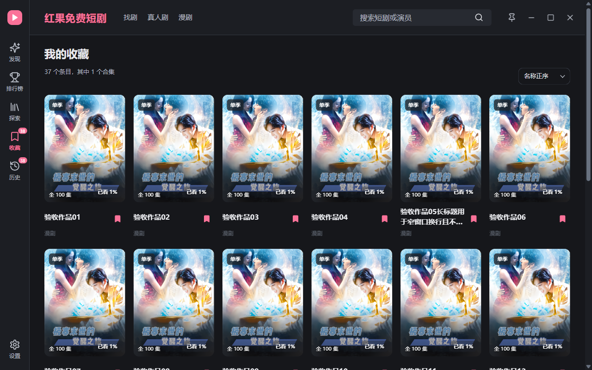
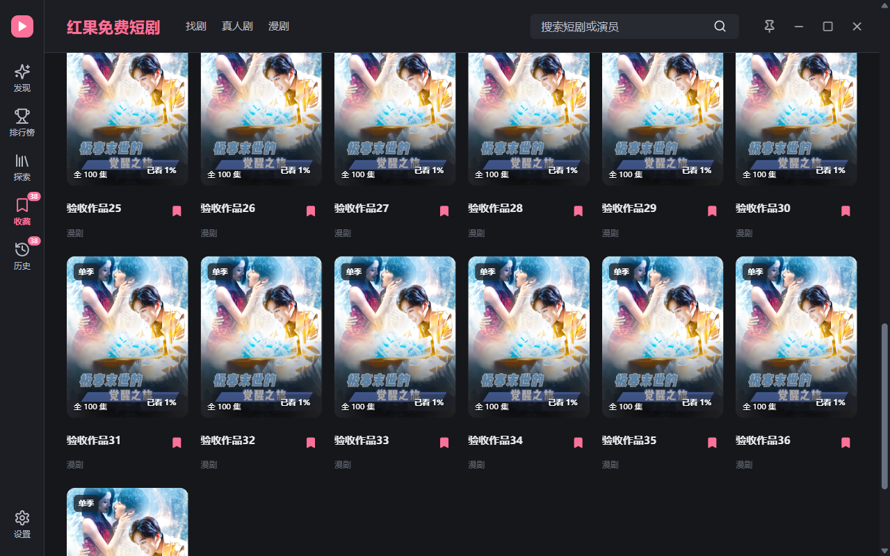

# 本机服务启动修复：合集恢复

这张来自实际安装版，真实目标合集41季仍在，保留季号倒序和中文原标题。两次启动检查的原生收藏99条、历史51条及内容签名一致。端口握手修正并不替代HTTP就绪检查；上游查询仍有独立的网络失败可能。

以下为此前34张窗口证据。

# 历史与收藏连续滚动：当前窗口截图

本轮3张来自实际安装的Windows/WebView2窗口，原图未修改。使用隔离目录中的37个根条目、38条原生收藏和历史，封面共用已有本地公开图片；不公开个人片单，也不代表上游搜索结果。

以下为此前批次截图；旧分页界面只保留作历史证据。

# 合集名称、排序与完整滚动：此前窗口截图

本轮7张均来自实际安装窗口，原图未修改。两张根页使用隔离记录，其他图只展示本次相关的真实合集；不公开整个个人片单。实际41季曾通过用户主动补齐加入原生收藏，截图本身只验证显示与保存，不保证搜索能找到所有剧的全部季。

## 合集显示“持械入宋”，各季原标题仍保留冒号。

本机真实目标合集，仅导航与读取。

## 真实41季一次列出，默认季号倒序，主题选择框带粉色键盘焦点。

本机真实目标合集，仅偏好与导航。

## 向下滚动到第1季，无合集内分页。

本机真实目标合集，仅偏好与导航。

## 640 CSS像素：选择框和两列季卡片保持在窗口内。

本机真实目标合集，仅偏好与导航。

## 收藏根页：最近添加、名称正序/倒序共用主题选择框，无额外排序标签。

隔离原生profile，人工记录与默认封面。

## 历史根页：最近观看排序，仍只保存实际输入的一条历史。

隔离原生profile，人工记录与默认封面。

## 重启后41季仍保存，最新季在前，排序偏好持久化。

本机真实目标合集，重启只读核验。

---

以下为此前24张验收原图。旧合集分页与旧排序展示已被上面的完整滚动和主题控件替代，保留用于追溯，不代表当前行为。

# 标题标点与副标题回退：此前隔离窗口截图

以下4张是此前安装版的实际窗口，隔离原生记录和固定搜索结果，默认封面。沿用已有深色主题；不代表线上该剧的真实季数。目标搜索先保留中文问号，再回退到主标题；加入仍核验合集ID。

## 补齐前：中文问号与副标题完整显示，系列只有一季。

## 补季等待：继续使用按钮右侧状态和取消入口，无顶部搜索横条。

## 补齐完成：同合集的不同副标题加入，关系未知仅显示人工收藏候选。

## 重启后：中文问号与两季原标题完整保存，合集仍为两季。

---

# 收藏与历史统一：本轮窗口截图

以下7张来自实际安装版本的隔离 WebView2 窗口，使用人工季度记录与默认封面。根页的合集季数一致；侧栏收藏/历史徽标保留各自真实记录数量，因此13与7不同属于预期。未修改原图。

## 收藏：同一合集共13季，最近第11季已看80%。

## 历史：同一合集同为13季、同一封面与80%进度，原生历史仍只有7季。

## 历史展开：包含全部13季；未观看的季如实标记，无删除历史按钮。

## 历史分页：每页12季，第二页显示第13季。

## 本地新归入第14季后自动收藏，两页更新为14季。

## 640 CSS像素：统一系列页与14季统计。

## 取消第14季收藏后重启：合集仍14季，收藏13条、真实历史8条，不自动恢复取消。

---

下面13张为此前导航与搜索状态验收证据；旧版成员独立行为已由本轮共享季度列表替代。

# 实际窗口截图

全部来自隔离测试窗口，原图未改；补季搜索和多页条目使用固定输入。先对比早期展开方式与统一系列页，再查看各搜索状态。截图不是设计稿，也不代表线上搜索完整性。

## 1. 早期实现：当前页面直接展开合集，提示另占行。并非上游原版截图。

## 2. 收藏根页：合集与单季标志、合集季数、50%观看进度与条目统计。

## 3. 补齐后合集共13季，最近观看季进度单行显示，背景40%不透明度。

## 4. 单季使用同一个系列页，只显示一季，进入页面不搜索。

## 5. 13季合集的第二页，只有第13季；每页12季。

## 6. 播放详情保留原播放与收藏操作，不再放补季面板。

## 7. 空闲状态，提示位于按钮右侧。

## 8. 搜索中同排文字与取消按钮，季列表位置保持。

## 9. 候选核验中，只替换同一处文字。

## 10. 完成后同排显示加入、跳过与确认数量，并保留搜索可能不完整提示。

## 11. 失败提示保留在同一位置，不新增下方状态行。

## 12. 取消中等待原生在途请求结束，再释放搜索槽。

## 13. 640 CSS像素窗口：状态单行省略，季卡片两列；只验收本次区域，顶部既有控件挤压未修复。

